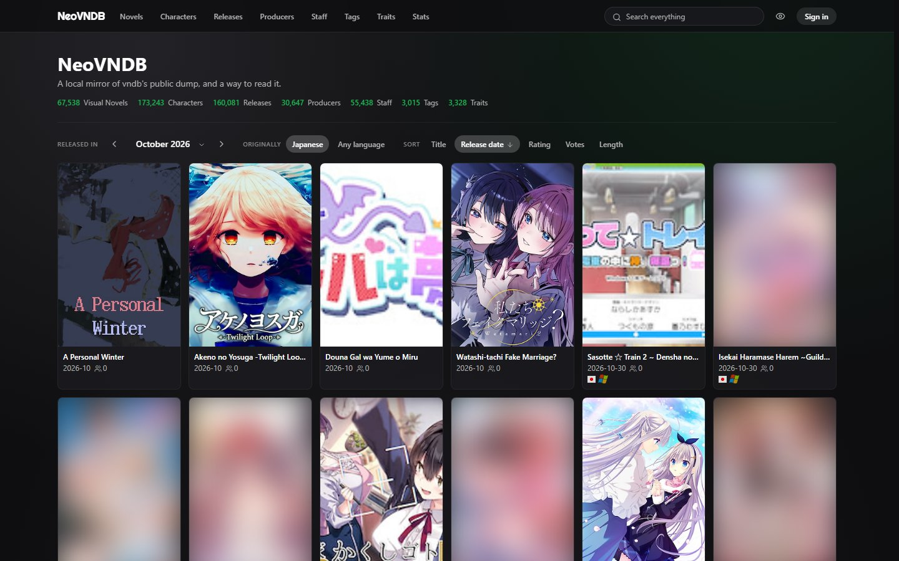
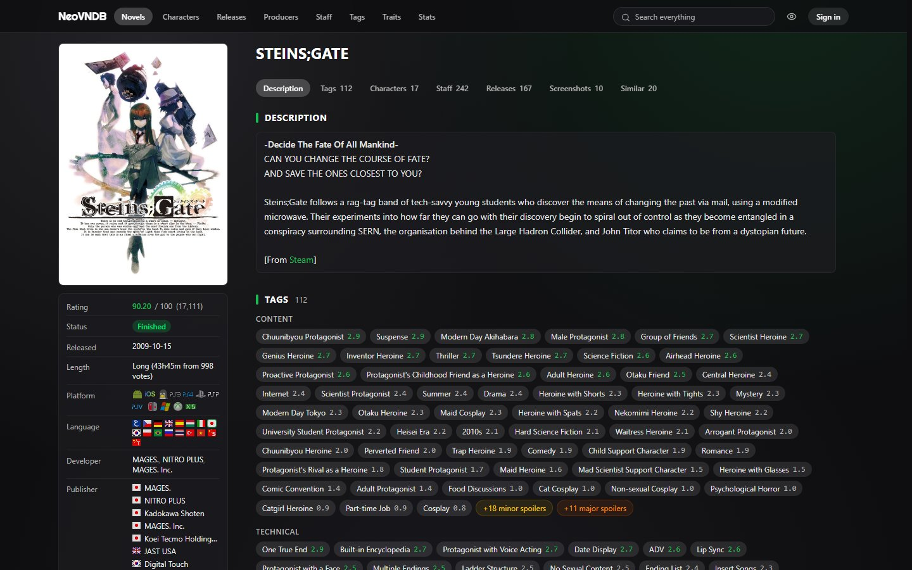
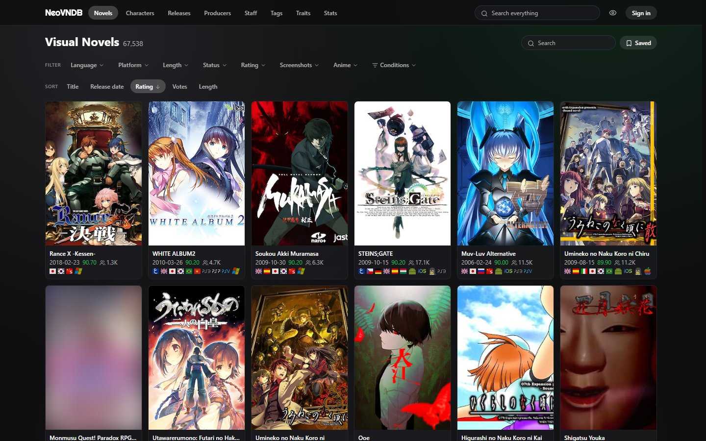
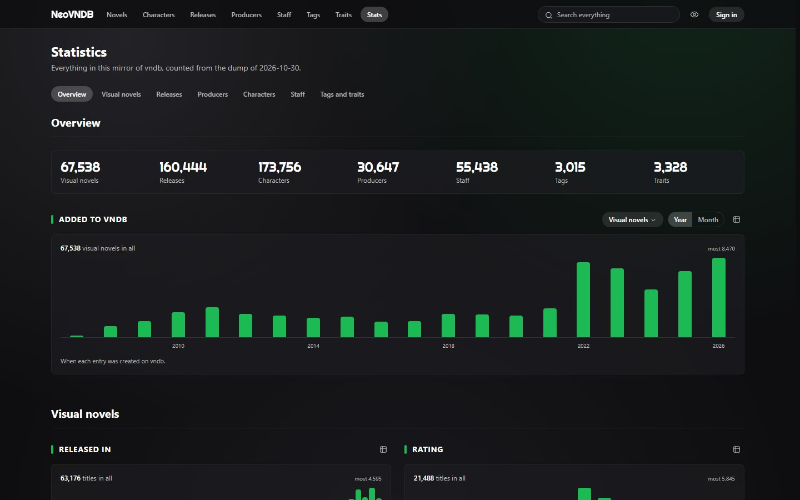
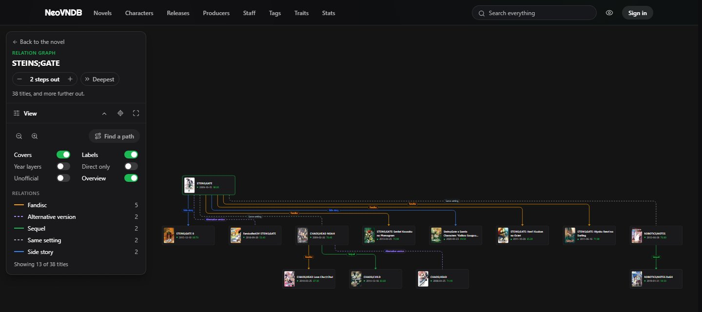

# NeoVNDB

A local mirror of the [VNDB](https://vndb.org) database, a read-only API over
it, and a site to browse it, with accounts and lists of its own.

The mirror is rebuilt from vndb's public dump, so nothing in it is authored
here. Readers' accounts, lists and ratings live in a separate service with its
own database, the one thing here that cannot be rebuilt from upstream.

| | |
| --- | --- |
|  |  |
|  |  |



The screenshots use the default content setting, *safe*: covers voted
suggestive or explicit are blurred until a reader chooses otherwise.

## What it does

- **Mirror.** Downloads vndb's dump, imports it into a fresh schema, derives
  what vndb computes but does not export (tag scores, closures, the search
  index), checks it against the live one, and swaps it in atomically. The
  previous generation is kept for a rollback. Updates run on a schedule.
- **Read API.** One query endpoint for all seven types (visual novels,
  releases, characters, producers, staff, tags, traits): field selection,
  a filter expression language with nesting (`release=(lang=en+freeware=true)`),
  sorting, search and paging. Also the relation graph, facet counts,
  similar titles, recommendations and whole-database statistics. It
  describes itself as OpenAPI 3.1 (`/vndbserve/meta/openapi`, rendered at `/api`).
- **Image mirror.** Keeps vndb's images byte for byte, fetched on first
  request and crawled ahead of readers; stored ones are served straight off
  disk.
- **Site.** Lists with a condition builder, detail pages, the relation graph,
  a global search, statistics, and for signed-in readers lists, ratings,
  saved searches, a dashboard and preferences that follow the account. Tag and
  trait names have a translation, with the original one switch away.
- **Admin page.** Generations, updates, rollback, the image crawl, user
  backups, translations and accounts, for administrators only.

## How it fits together

```
                        browser
                           |
                    edge (Caddy) :17030        the only address
     /vndbserve   /imgserve   /userserve   everything else
         |            |            |              |
   read API :17031  images :17032  users :17033  Next :17034
         |            |            |
      PostgreSQL   data/images  PostgreSQL
      (mirror)                  (accounts)
```

Every service binds `127.0.0.1`; only the edge faces the outside. Each prefix
forwards an allowlist of routes, and `/admin` routes only after the user
service confirms the caller is an administrator, so the read API and the image
mirror contain no authorisation code.

```
dl.vndb.org archive --COPY--> vndb_next --derive--> ALTER SCHEMA rename --> vndb
                                                     (vndb -> vndb_prev)
```

Responses are cached under the live generation's code, so a promote retires
the whole previous cache at once.

```
backend/vndb/    the mirror: read API, image mirror, importer, data layer
backend/users/   accounts, sessions, lists, ratings, saved searches
edge/            the Caddy config
frontend/        the site (Next.js)
docs/            design and structure notes (Chinese)
data/            archives, images and backups; reproducible, not in git
```

## Setup

Requires Go 1.27+, Node 24, pnpm, PostgreSQL 15+, Caddy 2, and `sqlc` to
regenerate the query layer. Each part reads the `.env` beside it; its
`.env.sample` lists every setting with the value a deployment wants.

```sh
cd backend/vndb
cp .env.sample .env               # set NEOVNDB_DB_URL
createdb neovndb
go run ./cmd/neovndb db init 20260819
go run ./cmd/neovndb update       # fetch and import the latest dump, then go live
go run ./cmd/neovndb trans seed   # load the translation corpus

cd ../users
cp .env.sample .env               # set NEOVNDB_USERS_DB_URL
createdb neovndb_users            # the schema is applied on start

cd ../../frontend
pnpm install
```

The local `.env` files turn every ceiling off (0 means none); the samples hold
the numbers a deployment wants.

## Running

```powershell
.\start.ps1 -Build           # build the Go services and the frontend, start all five, open the site
.\start.ps1 -BuildBackend    # build only the Go services
.\start.ps1 -BuildFrontend   # build only the frontend
.\start.ps1                  # start with the existing build
.\start.ps1 -Prod            # serve the production build instead of the dev server
.\start.ps1 -NoImages        # request no cover or screenshot (boxes keep their size)
.\start.ps1 -NoBrowser       # do not open the browser
.\start.ps1 -Force           # take ports that are already in use
.\start.ps1 -Stop            # stop a run left behind (or .\stop.ps1)
```

Ctrl+C stops everything. The dev server reads the source directly, so a
frontend change needs no build unless it runs with `-Prod`. The script reads
the services' ports and image directory from their `.env` files and hands them
to the edge, waits until each service answers, and logs each to
`<name>.out.log` / `<name>.err.log` in its own directory. Nothing starts
PostgreSQL.

Open the site at <http://127.0.0.1:17030>, never on Next's own port: only the
edge serves the API prefixes. Another device on the network can use this
machine's LAN address; `NEOVNDB_DEV_ORIGINS` adds any other name it is
reached by.

### The edge

Caddy has no `.env`; `start.ps1` sets its environment.

| Variable | Default | What it is |
| --- | --- | --- |
| `NEOVNDB_BIND` | `:17030` | where the edge listens |
| `VNDBSERVE_UPSTREAM` | `127.0.0.1:17031` | the read API |
| `IMGSERVE_UPSTREAM` | `127.0.0.1:17032` | the image mirror |
| `USERSERVE_UPSTREAM` | `127.0.0.1:17033` | the user service |
| `NEXT_UPSTREAM` | `127.0.0.1:17034` | the site |
| `NEOVNDB_IMAGE_DIR` | `../data/images` | stored images, served off disk |

## Deploying

1. Start each `.env` from its `.env.sample` and keep the sample's ceilings.
2. Set `NEOVNDB_USERS_SECURE_COOKIE=true` behind https, and keep
   `NEOVNDB_USERS_BCRYPT_COST=12`.
3. Make `NEOVNDB_IMAGE_DIR` absolute: the image mirror and the edge read it
   from different directories.
4. `.\start.ps1 -Prod -Build`, or `pnpm build` and `next start`; point
   `NEOVNDB_API_BASE` at the edge as the server reaches it.
5. Run `edge/Caddyfile` behind whatever terminates TLS, or import
   `edge/Caddyfile.snippet` into a shared edge's site block.
6. Make the first administrator on the machine:
   `go run ./cmd/users admin <name>` in `backend/users`.
7. `pnpm test:e2e:deployed` in `frontend/` runs every end-to-end test against
   a copy configured this way (the samples' ceilings, a production build, its
   own edge) beside the running site.

## Commands

`backend/vndb` (`go run ./cmd/neovndb <command>`, or `bin/neovndb.exe`):

| Command | What it does |
| --- | --- |
| `serve` | Run the read API; it also updates the mirror on a schedule |
| `images` | Run the image mirror; it also crawls ahead of readers |
| `crawl [--limit n]` | Fetch missing images now (`0`: all of them) |
| `update [--force]` | Import and go live if upstream is newer |
| `import [--file p] [--promote] [--force]` | Load an archive into `vndb_next` |
| `db status \| init <code> \| check \| promote \| rollback \| drop <schema> \| verify` | Inspect and manage generations |
| `trans status \| seed [file] \| export [file]` | The translation corpus, kept in `internal/trans/init.json` |

`backend/users` (`go run ./cmd/users`): no argument runs the service;
`backup` dumps the user database now; `admin <name> [off]` grants or revokes
administrator.

`frontend` (`pnpm <script>`): `dev`, `build`, `start`, `lint`, `format`,
`format:check`, `typecheck`, `typecheck:tests`, `test`, `test:watch`,
`test:e2e`, `test:e2e:deployed`.

### Scheduled jobs

Each job lives in the service it belongs to; nothing is registered with the
system scheduler. Each waits `*_FIRST_AFTER`, then runs every `*_EVERY`
(`0` turns it off), and never overlaps itself.

| Job | Runs in | Every (default) |
| --- | --- | --- |
| Update the mirror | `serve` | `NEOVNDB_UPDATE_EVERY` (24h), retry after `NEOVNDB_UPDATE_RETRY_AFTER` (1h) |
| Crawl images | `images` | `NEOVNDB_IMAGE_CRAWL_EVERY` (1h), `NEOVNDB_IMAGE_CRAWL_PER_RUN` (200) at a time |
| Expire sessions | user service | `NEOVNDB_USERS_SWEEP_EVERY` (1h) |
| Back up the user database | user service | when the newest is older than `NEOVNDB_USERS_BACKUP_EVERY` (a week) |

A new generation goes live only if it passes the guards: no table lost more
than `NEOVNDB_GUARD_MAX_LOSS` of its rows, none was skipped, no derived table
came back empty. Backups are `pg_dump` custom-format files; restore with
`pg_restore --clean --if-exists -d <database url> <file>`.

## Tests

```sh
cd backend/vndb  && go test ./...
cd backend/users && go test ./...
cd frontend      && pnpm test        # unit and component tests
cd frontend      && pnpm test:e2e    # end to end, against the running site
```

The user service's storage tests, and the end-to-end tests that sign in, need
`NEOVNDB_USERS_TEST_DB_URL` pointing at a database whose name ends in `_test`;
each run empties it. Without it they skip. `layout.spec.ts` checks every main
page at five widths for sideways overflow and measures layout shift on a
throttled line.

## Docs

`docs/` holds the design and structure notes, in Chinese:
`后端代码结构.md` (backend structure), `前端代码结构.md` (frontend structure),
`已实现功能.md` (what is done) and `拟实现功能.md` (what is planned or declined).
